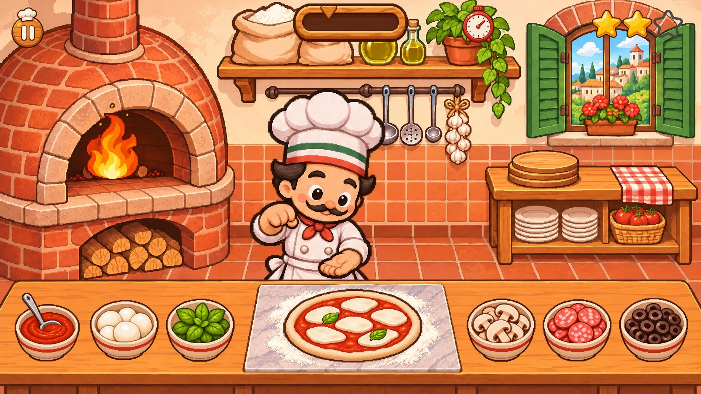

# Kit grafico — minigioco del pizzaiolo

Grafiche per un piccolo gioco da inserire nei siti delle pizzerie: un pizzaiolo assembla
la pizza al bancone e la cuoce nel forno a legna senza bruciarla.

Tutte le immagini sono state generate con **Higgsfield** (modello GPT Image 2.6, qualità alta)
in un unico stile: cartoon morbido, leggermente pixellato, contorni marrone scuro, palette calda.



## Inquadratura

Telecamera frontale alta in terza persona. Bancone con gli ingredienti in primo piano,
pizzaiolo che si muove dietro al bancone, forno a legna con fuoco visibile a sinistra.

## Contenuto

| Cartella | Cosa contiene |
| --- | --- |
| `backgrounds/` | Cucina orizzontale 1920×1080 (`kitchen.webp`) e verticale 1440×1920 (`kitchen_portrait.webp`). Per ognuna c'è il livello `*_counter.webp`: solo il bancone, trasparente sopra, da disegnare **sopra** il pizzaiolo. Il forno è senza fiamme: il fuoco è un'animazione a parte. |
| `chef/` | 21 pose + ciclo di camminata a 8 frame (`walk_1`…`walk_8`). Tutte sulla stessa tela 657×686 con ancora ai piedi, quindi si scambiano senza scatti. |
| `ingredients/` | Vassoio di panetti e 8 ciotole: pomodoro, mozzarella, basilico, funghi, salame piccante, olive, prosciutto cotto, peperoni. |
| `pizza/` | Panetto, base cruda, con pomodoro, con mozzarella, cotta, troppo cotta, bruciata, margherita finita, pala. Gli stati hanno la stessa dimensione e si sovrappongono esattamente. |
| `toppings/` | 12 pezzi singoli da spargere sulla pizza. |
| `fx/` | Fumo, vapore, farina, scintille, cuore, goccia; `fire_strip.png` (8 frame, 10 fps) e `fire_alt_strip.png` (12 frame, 12 fps). |
| `ui/` | Pannello in legno, biglietto ordine, pulsanti (play, replay, pausa, audio), stelle, cornice e cursore della barra di cottura, timer, mano per il tutorial. Nessun testo. |
| `concept/` | Immagine guida dello stile e scena di prova montata con gli sprite. |
| `source/` | Fogli originali di Higgsfield a piena risoluzione. |
| `manifest.json` | Elenco di sprite e animazioni con dimensioni e ancore, più le posizioni consigliate nella scena orizzontale (fuoco, pizzaiolo, pizza, ciotole, pala). |

## Note per lo sviluppo del gioco

- Ordine di disegno: sfondo → bagliore e fuoco → pizza nel forno → pizzaiolo → livello bancone → ciotole → pizza sul marmo → effetti → interfaccia.
- Dietro al bancone il pizzaiolo ha le gambe nascoste. Quando va al forno sale verso il fondo
  (`layout.chef.oven`), così la pala arriva all'altezza della bocca del forno.
- Camminata e pose con la pala guardano a sinistra o a destra: per l'altra direzione si specchiano.
- La pizza sul marmo va schiacciata in verticale (`layout.pizza.squashY`) per seguire la prospettiva del bancone.
- Lo sfondo verticale è pronto, ma le posizioni per quel formato sono ancora da definire.
- Gli sprite sono PNG senza perdita. Per il sito conviene convertirli in WebP e unirli in atlas.

## Rigenerare gli sprite dai fogli

```bash
python3 tools/build_assets.py   # ritaglia i fogli in source/ e riscrive sprite e manifest
python3 tools/make_preview.py   # rimonta concept/scene_preview.webp
```

Servono Python 3 con Pillow e NumPy.

## Formula di stile

Questa frase è stata inserita identica in ogni prompt. Va riusata tale e quale per generare
nuovi elementi coerenti con il kit, passando un'immagine del kit come riferimento.

> Polished modern pixel art with a soft cartoon feel: fine visible pixel grid, smooth clean pixel clusters and gentle cel shading, lightly pixelated never blocky or noisy. Rounded chubby shapes with thick dark espresso-brown outlines. Environment in warm terracotta brick, cream plaster and honey-colored wood; the chef in a bright white uniform with a tomato-red neckerchief that pops against it; fire and heat in vivid orange-yellow glow. Cozy cheerful Italian pizzeria mood, warm soft light. High contrast between game elements and backgrounds, clean readable silhouettes, consistent elevated frontal high-angle view across all assets.

Per gli sprite su sfondo trasparente: formato quadrato 1:1 e parametro `background: transparent`
(con il formato 3:2 il modello ha ignorato la trasparenza).

## Fogli originali e job Higgsfield

| File in `source/` | Job |
| --- | --- |
| `keyart.png` | `d9799aab-79bb-43fb-8976-27c5bdd2fe30` |
| `bg_kitchen.png` | `ac06e71a-c604-4220-9864-de1bd8ff27b9` |
| `bg_kitchen_portrait.png` | `2c95ebc2-ccc2-4be8-a9b1-2b6d621b6f3d` |
| `chef_core.png` | `85524c52-1fbe-4508-af71-ef3eff6ef49a` |
| `chef_emotes.png` | `2eb2bfc2-6bb0-4a60-a447-992af691043b` |
| `chef_walk.png` | `1da5f75b-fd50-4a8b-88a7-abecfe734b51` |
| `ingredient_bowls.png` | `f8d05124-3e7d-42bd-93c4-d24f008cfb9f` |
| `pizza_states.png` | `2cdd31b3-d408-43e7-8aee-dacd3727acad` |
| `toppings.png` | `d1ea65e5-5824-448b-828e-23aabbb9e956` |
| `fx.png` | `7c31bd98-d8c3-4814-b1a8-cb911ef23e88` |
| `ui.png` | `2cac376f-c23d-4b52-af48-3387d69b2a56` |
| `fire_sheet.png` | `5b9e2627-7f8e-4687-9522-7051fd288218` |
| `fire_loop.gif` | `df0e3cf5-e782-44ed-8a35-a2e99bdf0546` |
